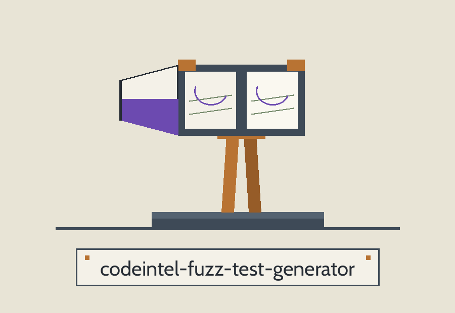
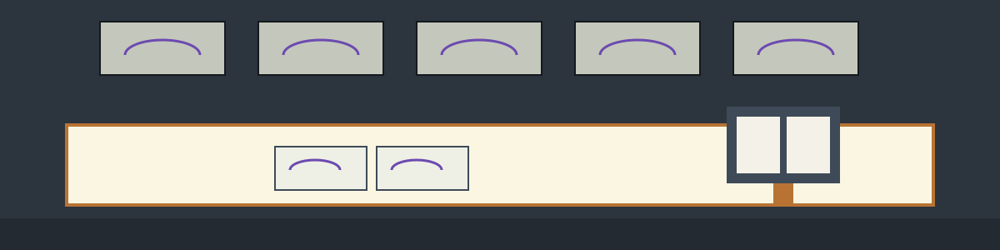

# codeintel-Fuzz-Test-Generator

Specimen label treatment: the title is set in Be Vietnam Pro on a lab white plate ruled as a specimen label, with the single stereoscope drawn once as a header plate beneath the banner, and the remaining headings stay typographic, as specimen labels in Cabin.

Generates basic fuzz tests based on code structure and function signatures, focusing on boundary conditions and common error patterns. - Focused on Tools for static code analysis, vulnerability scanning, and code quality assurance

The target module is read and parsed from its syntax tree only. It is never imported or executed, so its top level code does not run during generation. A run exits 1 when the target cannot be read or parsed, and exits 1 when a readable module defines no functions of its own. A failed run writes no output file.

> **Specimen label, on the printout.** A generated file reports its failures only in its printout: the generated tests catch their own exceptions and merely print them, so the exit code of a generated file stays at nought even when a case has failed.

## Install
`git clone https://github.com/ShadowStrikeHQ/codeintel-fuzz-test-generator`

> **Specimen label, flagged in place.** The install line above reads git clone https://github.com/ShadowStrikeHQ/codeintel-fuzz-test-generator, naming ShadowStrikeHQ in place of ShadowGuard-AI. It is preserved exactly as printed and flagged here, never silently fixed.

## Usage
`./codeintel-fuzz-test-generator [params]`

## Parameters
- `-h`: Show help message and exit
- `--num_tests`: Number of fuzz tests to generate per function. Defaults to 10.
- `--string_length`: Length of random strings used in fuzzing. Defaults to 10.
- `--int_min`: Minimum integer value for fuzzing. Defaults to -100.
- `--int_max`: Maximum integer value for fuzzing. Defaults to 100.
- `--output_file`: Optional file to save the generated tests to. If not provided, tests will be printed to stdout.

## License
Copyright (c) ShadowStrikeHQ

> **Specimen label, flagged in place.** The closing line above reads Copyright (c) ShadowStrikeHQ, while the repository LICENSE file carries the MIT License. Both stand as printed; neither is forced to agree with the other.
